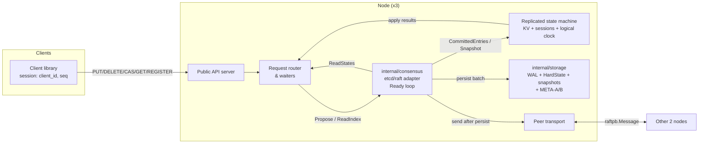
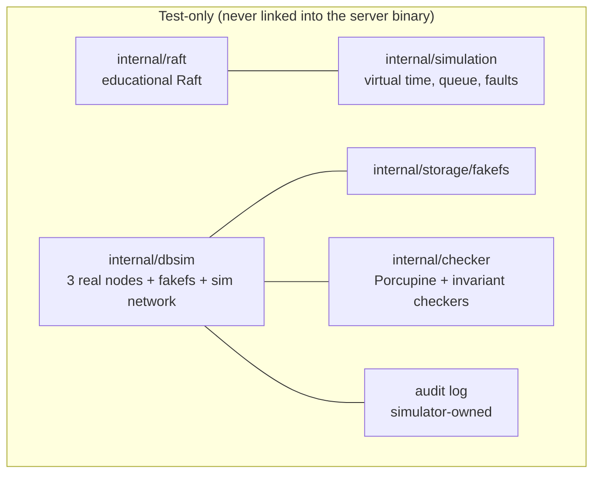
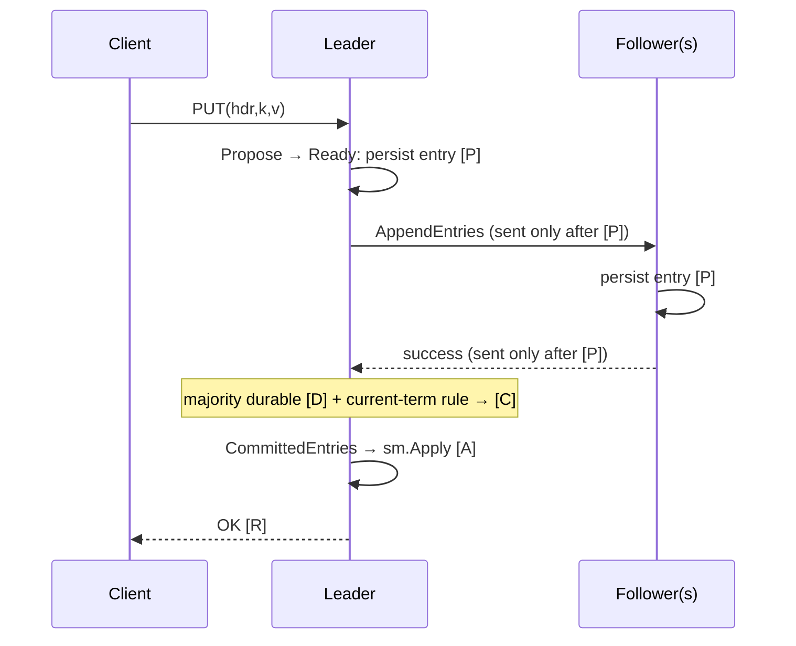

# LogstoneDB — Architecture and System Specification

> **Authorship:** generated by Claude (AI assistant, Anthropic) on 2026-10-10 from the LogstoneDB master prompt, the original challenge document, and three rounds of written review. **Not written by the human operator (Aaditya Adhikari).** No code has been written or executed for this package.
> **Status:** draft v0.1 for architecture review. Authoritative once reviewed. Items marked **PROVISIONAL — NOT YET VERIFIED** are designs that have only survived written review.

## Document map

| File | Contents |
|---|---|
| `LOGSTONEDB_ARCHITECTURE.md` | This file: overview, components, sequences, evidence table, risks, questions, first milestone |
| `docs/assumptions.md` | Fault model, storage contract, timing, client contract, exclusions |
| `docs/invariants.md` | Safety and liveness properties, mechanisms, counterexamples, test IDs |
| `docs/protocol.md` | Client API, errors, sessions/dedup, command encoding, transport, etcd/raft Ready contract |
| `docs/storage.md` | WAL, HardState, snapshots, generations, recovery, fakefs **(PROVISIONAL)** |
| `docs/testing.md` | Simulators, fault injection, Porcupine, test matrix, evidence rules |
| `docs/roadmap.md` | 14-day gate and 24-week plan |
| `docs/decisions.md` | ADRs, change control |
| `docs/review-log.md` | Review findings and resolutions |

---

## 1. Problem statement

Build a small distributed key-value database that stays **correct** (linearizable, durable for acknowledged writes) under crashes, restarts, message loss/delay/duplication/reordering and network partitions, and **show the evidence**. The point is not features or speed; it is a narrowly scoped system whose correctness claims are each backed by an executable test.

## 2. Measurable goals (v1.0)

| ID | Goal | Measure |
|---|---|---|
| G1 | Linearizability | 0 Porcupine violations over 10,000 bounded randomized histories with faults (DB-L01) |
| G2 | Acknowledged-write durability | 0 lost acknowledged writes across all supported crash campaigns (F01, DB-CR01/02) |
| G3 | Crash recovery | 1,000 randomized leader crash/recovery trials pass |
| G4 | Catch-up | Follower catches up after ≥ 100,000 committed ops (log and snapshot paths) |
| G5 | Stability | 24-hour run: no unrecovered panic, no goroutine leak |
| G6 | Availability | Operations continue with any 2 of 3 nodes connected |
| G7 | Reproducibility | Every failure reproducible from a seed; benchmarks reproducible with documented hardware |

## 3. Non-goals

SQL, multi-key transactions, sharding, membership changes, cross-region, TLS/auth, dashboard, production operations, custom production Raft, formal proof. See `docs/assumptions.md` §6–7.

## 4. Research contribution and limitations

**Contribution (modest, honest):** an end-to-end, evidence-mapped account of what it takes to turn a consensus library into a linearizable, crash-safe store: Ready-loop ordering, batch-atomic WAL recovery, generation-safe snapshot publication, replicated deduplication, and deterministic fault testing with an independent audit trail.

**Limitations:** single shard, 3 fixed nodes; in-memory state machine; custom WAL tested mainly against a fake filesystem model; finite testing is evidence, not proof; storage rollback and majority disk loss are excluded; AI-assisted authorship (this package and possibly later code) must be disclosed in any report.

## 5. High-level architecture





**Deployment topology:** three processes, node IDs 1, 2, 3, each on its own host (or container) with a local SSD data directory. Static config file lists `{node_id, peer_addr, client_addr}` for all three plus `cluster_id`, identical on every node (startup checks a config hash). Clients know all three client addresses.

## 6. Components and ownership

| Component | Package | Owns | Must not |
|---|---|---|---|
| Public API | `internal/api` | Request validation, size limits, error mapping | Touch state machine directly |
| Request router & waiters | `internal/server` | Pending proposals keyed by `(client_id, seq)` or proposal ID; pending reads keyed by `rctx`; deadlines | Decide dedup outcomes (state machine does) |
| etcd/raft adapter | `internal/consensus` | `raft.Node`, tick loop, Ready loop ordering (`docs/protocol.md` §8), `MemoryStorage` mirror | Send messages before persistence |
| Peer transport | `internal/transport` | Connections, framing, `ReportUnreachable`, `ReportSnapshot` | Assume ordering or delivery |
| WAL / HardState store | `internal/storage/wal` | Batches, sync, recovery, truncate markers | Retry a failed sync |
| Snapshot & generation manager | `internal/storage/snap`, `internal/storage/meta` | Snapshot files, META-A/B, publication, cleanup | Delete anything before commit point |
| Replicated state machine | `internal/sm` | KV map, sessions, logical clock, `Apply`, `Snapshot`, `Restore` | Read the log; use wall clock; iterate maps unsorted in outputs |
| Client library | `pkg/client` | Session, seq, retries, optional persisted session file | Change content of a retried request |
| Educational Raft | `internal/raft` | Own simplified Raft, pure functions | Any I/O, goroutines, wall clock |
| Simulation | `internal/simulation` | Virtual clock, queue, faults, rng, trace | Be imported by server code |
| DB simulation | `internal/dbsim` | Wiring of real components under fakefs + simulated network; barriers; failpoints | Be linked into the server binary |
| Fake filesystem | `internal/storage/fakefs` | Executable storage contract | — |
| History checker | `internal/checker` | Porcupine model, invariant checkers | — |
| Metrics & harness | `internal/metrics`, `bench/` | Counters, histograms, benchmark runner | Report throughput as correctness |

## 7. Module structure, dependency direction, interfaces

```
logstonedb/
├── LOGSTONEDB_ARCHITECTURE.md
├── cmd/
│   ├── logstonedb/            # server binary: bootstrap | start | unsafe-recover
│   └── simulator/          # educational simulator CLI
├── internal/
│   ├── raft/               # educational Raft (pure)
│   ├── simulation/         # virtual time, network, faults, trace
│   ├── consensus/          # etcd/raft adapter
│   ├── sm/                 # state machine
│   ├── storage/{wal,snap,meta,fs,fakefs}/
│   ├── transport/
│   ├── server/  api/
│   ├── dbsim/  checker/  metrics/
├── pkg/client/
├── tests/{sim,dbsim,integration}/
├── bench/
└── docs/
```

**Dependency direction (enforced by a simple `go list` check in CI):**
- `internal/raft` → stdlib only.
- `internal/simulation` → `internal/raft`.
- Server path: `api → server → {consensus, sm}`; `consensus → {storage, transport}`; `storage → storage/fs`.
- `sm` depends on nothing but stdlib.
- `dbsim`, `checker`, `fakefs` are imported only by tests and `dbsim`.
- No server package imports `internal/raft` or `internal/simulation`.

**Key interfaces (signatures only; not the Raft core):**

```go
// internal/storage/fs
type FS interface {
    Create(name string) (File, error); OpenAppend(name string) (File, error)
    Open(name string) (File, error);   Rename(oldName, newName string) error
    Remove(name string) error;         ReadDir(dir string) ([]string, error)
    MkdirAll(dir string) error;        SyncDir(dir string) error
}
type File interface { io.ReadWriteCloser; io.ReaderAt; Sync() error; Truncate(int64) error; Size() (int64, error) }

// internal/storage
type Store interface {
    Load() (Recovered, error)                                   // runs startup invariants I0–I9
    SaveReady(ents []raftpb.Entry, hs raftpb.HardState, snap raftpb.Snapshot, mustSync bool) error
    PublishSnapshot(snap raftpb.Snapshot, body []byte) error    // generation protocol
}

// internal/sm
type StateMachine interface {
    Apply(e raftpb.Entry) Result          // deterministic; includes dedup
    Snapshot() (index, term uint64, body []byte)
    Restore(body []byte) error
    Get(key []byte) ([]byte, bool)        // only via ReadIndex path
    AppliedIndex() uint64
}

// internal/raft (educational)
type Output struct { Msgs []Message; Persist *PersistState; Apply []Entry }
func (n *Node) Step(m Message) Output
func (n *Node) Tick() Output
```

## 8. End-to-end sequences

Markers: **[P]** persisted on this node (synced) · **[D]** durable on a majority · **[C]** commit known to leader · **[A]** applied on this node · **[R]** response.

### 8.1 Write (PUT / DELETE)


If leadership is lost between Propose and [R]: `TIMEOUT` (outcome unknown).

### 8.2 CAS
Same as 8.1. `sm.Apply` evaluates the session rules first (`docs/protocol.md` §5.2); only a new `seq` executes the compare; the result (`swapped`, `current`) is cached in the session. A retry returns the cached result without comparing again.

### 8.3 Linearizable GET (ReadIndex)
1. Router creates unique `rctx`; `node.ReadIndex(ctx, rctx)`.
2. Leader (etcd/raft) ensures it has committed in its current term; records read index = commit; sends heartbeats carrying `rctx`.
3. Majority acknowledgements for that `rctx` in the current term → `ReadState{Index, rctx}` in Ready.
4. Router waits until `sm.AppliedIndex() ≥ Index` **[A]**, reads, responds **[R]**.
5. No majority → no ReadState → `TIMEOUT` / `NOT_LEADER`. Never a local read.

### 8.4 Leader change
1. Leader isolated; CheckQuorum makes it step down after an election timeout; its waiters fail with `TIMEOUT`.
2. Majority side: PreVote, then election; votes persisted [P] before replies.
3. New leader appends a no-op; commits it [C] (establishes commit index; indirect commit of prior-term entries).
4. Clients retry at the new leader with the same `(client_id, seq)`; dedup in apply ensures at-most-once.
5. Old leader rejoins, sees higher term, becomes follower; conflicting uncommitted suffix replaced via `TRUNCATE_SUFFIX` batch.

### 8.5 Crash and restart (process crash, disk intact)
1. `Store.Load()`: identity check; choose metadata generation; validate snapshot and segments; WAL recovery (torn-tail rule); invariants I0–I9.
2. Populate `MemoryStorage` (snapshot, HardState, entries).
3. `sm.Restore(snapshot)`; `Config.Applied = snapshot.index`; `RestartNode`.
4. etcd/raft delivers committed entries above `Applied` up to the durable `Commit` → replayed through `sm.Apply` [A] (dedup state rebuilt identically).
5. Node learns newer commits from the leader; catches up.

### 8.6 Snapshot creation and log compaction (local)
1. Apply goroutine captures consistent cut at index N (`applied ≥ N`, durable Commit ≥ N).
2. Snapshot file written with `created_gen = G+1`, synced; dir synced.
3. META-A ← G+1; META-B ← G+1 (each tmp/sync/rename/sync-dir). **Commit point.**
4. Cleanup of artifacts unreferenced by G+1; `MemoryStorage.Compact(N)`.

### 8.7 Snapshot install on a lagging follower
1. Leader sends `MsgSnap`; transport streams it; `ReportSnapshot` on completion/failure.
2. Follower's Ready contains `Snapshot`: storage writes snapshot file, publishes G+1 (both slots) **before** the Ready step completes; only then are the Ready's messages (which carry the acknowledgement) sent.
3. `sm.Restore(snapshot)`; applied = N.
4. Crash before step 2's commit point → snapshot not acknowledged; leader resends.

### 8.8 Recovery decision flow (storage)
```
identity OK? ─no→ REFUSE
  │yes
metadata: any valid slot? ─no→ FAIL-STOP
  │yes → active = max gen
referenced artifacts all valid? ─no→ FAIL-STOP (never fall back)
  │yes
WAL scan: damage only in incomplete final batch? ─no→ FAIL-STOP
  │yes → truncate tail, sync
invariants I2–I8 hold? ─no→ FAIL-STOP
  │yes → cleanup orphans → start
```

## 9. Safety invariants, fault assumptions, fail-stop behaviour

- **Invariants:** S1–S5, R-COMMIT, R-APPLY, L-ACK, L-READ, L-DEDUP, ST-1..3, ID-1 (`docs/invariants.md`).
- **Fault model:** N1–N5, P1–P4, storage contract S1–S7; timing T1 (none) for safety (`docs/assumptions.md`).
- **Fail-stop triggers:** any sync/write error; checksum failure outside an incomplete final batch; missing referenced artifact; startup invariant violation; unknown command version during apply; identity mismatch.
- **Fail-stop behaviour:** stop Raft participation and client service; send no further messages; log a structured reason; exit non-zero (or stay up in diagnostic mode serving only `STATUS = FAIL_STOPPED`).

## 10. API, configuration, membership, identity

- API and errors: `docs/protocol.md` §1–3.
- **Configuration (identical on all nodes, hashed and checked at peer handshake):** `cluster_id`, node list, tick interval (100 ms), `ElectionTick` 10, `HeartbeatTick` 1, CheckQuorum, PreVote, ReadOnlySafe, session TTL (1 h) and cap (10,000), request deadline (2 s), segment size (64 MiB), snapshot threshold (10,000 entries).
- **Fixed membership:** nodes 1, 2, 3 forever. IDs never reused (etcd/raft requirement, README verified 2026-10-10).
- **Bootstrap:** `logstonedb bootstrap --cluster-id X --node-id N` on an empty directory, once per node; `start` refuses an empty or foreign directory (ID-1).
- **Majority storage loss:** cluster unavailable; only `unsafe-recover` (offline, explicit, logs possible data loss).

## 11. Storage design — PROVISIONAL — NOT YET VERIFIED

Summary only; full specification in `docs/storage.md`.
- WAL of batches (`records + COMMIT`), chained CRC32C, synced per Ready; HardState inside the batch; suffix replacement via `TRUNCATE_SUFFIX` marker. **PROVISIONAL.**
- Recovery: truncate only an incomplete final batch; fail-stop on middle corruption, on later valid COMMIT after damage, and on `Commit > last index`. **PROVISIONAL.**
- Snapshots: consistent cut incl. sessions; generation G+1 published to both META slots before any dependent action; never fall back. **PROVISIONAL.**
- Known limitation: corruption destroying the whole final-segment tail is indistinguishable from a torn tail (risk R7).
- Executable storage contract: `fakefs` (Weeks 3, 14–16). Real-filesystem behaviour beyond the model remains unproven.

## 12. Performance methodology

- **Correctness first:** benchmarks run only on builds whose full regression suite (G5 gate) passes; every benchmark run also runs a short Porcupine-checked history.
- **Setup recorded:** CPU model, cores, RAM, disk model and filesystem, kernel, Go version, commit hash, config, `GOMAXPROCS`.
- **Workloads:** 100% PUT; 95/5 GET/PUT; 50/50; CAS contention on 10 hot keys; value sizes 64 B / 1 KiB / 16 KiB; 1, 16, 64 concurrent clients; leader-failover during load; snapshot during load.
- **Metrics:** throughput (ops/s); latency p50/p95/p99/max from client-side histograms (HDR-style, coordinated-omission-aware open-loop generator); fsyncs per second and per op; batch sizes.
- **Procedure:** 30 s warm-up, 3 × 120 s runs, report median and range; fsync time profiled separately.
- **Never:** compare numbers across different hardware without labelling; report throughput from a run with a correctness failure; disable fsync for benchmarks (unless clearly labelled as a separate, non-durable experiment).

## 13. Testing strategy and correctness evidence table

Strategy in `docs/testing.md`. Each claim maps to at least one executable test or checker; **none exist yet**.

| Claim | Invariant | Evidence (planned) | Phase |
|---|---|---|---|
| One leader per term | S1 | SIM-E01, SIM-E05 + mutant; etcd/raft in dbsim F04 | W1–2, W11 |
| Log matching | S3 | SIM-R01/02/05 + mutant | W2 |
| Committed entries survive leader changes | S4, R-COMMIT | SIM-C01/C02 + mutants; F01, F06 | W2, W10 |
| No uncommitted value ever applied/visible | R-APPLY, S5 | SIM-R04; DB-RD01 | W2, W12 |
| Acknowledged writes durable | L-ACK | F01, F02, DB-CR01/02, STO-W03/W08 | W10, W16 |
| Linearizable reads | L-READ | F09, DB-RD01–04, DB-L01 (Porcupine) | W12, W20 |
| CAS at-most-once under retry | L-DEDUP | F07, F08, DB-DD01–05, audit log | W13 |
| Sessions survive snapshot/restart | L-DEDUP, ST-3 | STO-S01, §6.4 test | W14 |
| WAL recovery never loses synced batch | ST-1 | STO-W01–W07 | W3, W16 |
| No fallback to obsolete generation | ST-2 | STO-M01–M06 | W14–16 |
| Disk error → fail-stop | ADR-012 | F11, STO-W08 | W16 |
| Empty-storage node never rejoins | ID-1 | F12, DB-ID01 | W9, W16 |
| Determinism of all simulators | — | SIM-D01; dbsim trace-hash replay | W1, W5 |

## 14. Observability, logging, trace format, seeds

- **Structured logs** (JSON lines, `log/slog`): `ts, node, term, role, event, index, commit, applied, client_id, seq, err`.
- **Metrics:** proposals, commits, applies, read-index latency, fsync latency histogram, batch size, leader changes, session table size, fail-stop reason.
- **Simulation trace line:** `step=<n> t=<virtual_ms> node=<id> ev=<kind> from=<id> to=<id> term=<t> detail=<...> rng=<draw>`; trace hash printed at the end of each run.
- **Seeds:** every randomized run prints its seed first; `-seed`, `-seeds a-b` flags; a failing seed is turned into a named regression test.
- **Failure bundle:** seed, trace, final state of every node, Porcupine visualization (if any), written under `docs/results/failures/<date>-<seed>/`.

## 15. Plan, gate, decisions

### 15.1 Plan and gates
- 14-day feasibility gate and 24-week plan: `docs/roadmap.md`. Gates G0–G6; G3 and G5 are never descoped.
- Acceptance for v1.0: goals G1–G7 (§2) met with evidence per `docs/testing.md` §8, evaluator approval.

### 15.2 Classification

| Category | Items |
|---|---|
| **Agreed** (prior review) | Go; separate educational Raft; etcd/raft for DB; ReadIndex only; replicated sessions direction; in-memory SM; rollback excluded; fakefs deferred past Day 2; barrier rule for tests |
| **Proposals** (this package) | Custom WAL with batch framing; HardState in WAL; two-slot metadata; session cap refuses registration; QUERY_OUTCOME; conservative Ready ordering; no proposal forwarding; gRPC API; config values |
| **Assumptions** | `docs/assumptions.md` (N, P, S, T, C series) |
| **Unresolved** | §18 questions; `docs/assumptions.md` §8; `docs/storage.md` §11 |

## 16. Architecture completeness checklist

- [x] Problem statement, goals, non-goals, contribution, limitations (§1–4)
- [x] Diagram and topology (§5)
- [x] Components, ownership, interfaces, dependency direction (§6–7)
- [x] Write, CAS, ReadIndex, leader change, crash/restart, snapshot, install, recovery sequences (§8)
- [x] Invariants with mechanisms and counterexamples (`docs/invariants.md`)
- [x] Fault model, storage contract, exclusions (`docs/assumptions.md`)
- [x] API, errors, sessions, retries, transport (`docs/protocol.md`)
- [x] Ready/Advance contract with source checked (`docs/protocol.md` §8)
- [x] Storage spec marked provisional (`docs/storage.md`)
- [x] Test matrix incl. all required adversarial cases; evidence rules (`docs/testing.md`)
- [x] 14-day gate and 24-week plan with hours (`docs/roadmap.md`)
- [x] ADRs and change control (`docs/decisions.md`); review log
- [ ] etcd/raft version pinned and version-specific behaviour verified (Week 6)
- [ ] Porcupine version pinned and unknown-outcome handling verified (Week 18)
- [ ] Go version and darwin `Sync` behaviour verified (Milestone 0)
- [ ] Operator-authored `docs/invariants-operator.md` (Day 2)
- [ ] Any test exists or has run (none yet)

## 17. Risk register (prioritized)

| # | Risk | Likelihood | Impact | Mitigation | Trigger to act |
|---|---|---|---|---|---|
| R5 | Operator cannot explain or defend AI-generated design/code; evaluator gate fails | High | High | Operator writes Raft simulator core and invariants personally; AI reviews, does not author core; disclose authorship | Operator can't explain a trace on request |
| R1 | Schedule: 15–20 h/week alongside studies and client work | High | High | Fixed descoping order (`docs/roadmap.md`); weekly hour log | Two consecutive weeks < 12 h |
| R2 | etcd/raft Ready-ordering mistakes (sending before persist, mishandling snapshots) | Medium | Critical | Conservative ordering (ADR-013); dbsim tests with failpoints between every step | Any F01/F02/STO failure |
| R3 | Custom WAL recovery bugs | Medium | Critical | Batch framing, exhaustive truncation/corruption tests, mutants | Any STO-W failure |
| R6 | Nondeterminism in simulators (maps, goroutines, time) | Medium | High | Single-threaded event loops; sorted iteration; trace-hash determinism test | SIM-D01 fails |
| R4 | fakefs model passes but real disks differ | Medium | High | State model limits; optional LazyFS runs; no real-disk durability claims beyond evidence | — |
| R8 | Porcupine model or ambiguous-op handling wrong → false passes | Low | High | Planted stale-read and double-apply mutants must be caught | Mutant passes checker |
| R7 | Undetectable destruction of final-segment tail | Low | High | Documented limitation; v2 high-water mark | — |
| R9 | Scope creep (follower reads, leases, membership) | Medium | Medium | ADR required for any addition | Unplanned feature PR |

## 18. Blocking questions for the evaluator (max 10)

1. Is the **two-slot, write-both-before-acting** metadata protocol (`docs/storage.md` §6) acceptable as the v1 design to implement, given rollback is excluded?
2. Is **keeping a complete batch whose sync never returned** (`docs/storage.md` §5.3) acceptable, given S2 says unsynced data may survive?
3. Is the **accepted limitation** in `docs/storage.md` §5.4 (tail-destroying corruption looks torn) acceptable for v1?
4. Is a **custom WAL** (ADR-005) acceptable, or do you require etcd's WAL package to reduce risk?
5. Is **refusing registration at the session cap** plus `QUERY_OUTCOME` sufficient for finding R3-3?
6. Does the **conservative Ready ordering** (persist before any send, no leader parallel writes) satisfy you, or do you want the library-minimum ordering documented as well?
7. For the 14-day gate, is the **simulator persistence model** in `docs/testing.md` §2.3 (explicit persisted term/vote/log, no fakefs) sufficient?
8. What level of **authorship separation** do you require: is it enough that the operator writes `internal/raft` and `internal/simulation` and AI-generated code is labelled in commits?
9. Should a node that lost its storage be **permanently out** in v1 (current decision), or do you require an offline re-seed procedure?
10. Is the **evidence standard** in `docs/testing.md` §8 (command, versions, raw output, mutants) what you will grade against?

## 19. First implementation milestone after review

**Milestone 0 — Skeleton and boundaries (Days 1–2; operator-authored).**
- Files: `go.mod` (Go version recorded), directory tree per §7, `cmd/simulator/main.go` printing a seed, empty packages `internal/raft` and `internal/simulation` with package docs, `docs/invariants-operator.md` (operator's own words), rollback exclusion in `docs/assumptions.md` (operator's wording), `Makefile` or script with `go vet ./...`, `go test -race ./...`, and a dependency-direction check (`go list -deps ./internal/raft` must show stdlib only).
- Acceptance: commands run clean; evaluator reviews `invariants-operator.md` before Day 3.
- Explicitly not in Milestone 0: any Raft logic, fakefs, etcd/raft, networking.

**Stop here:** this package requests architecture review. No database code until the reviewer responds.
